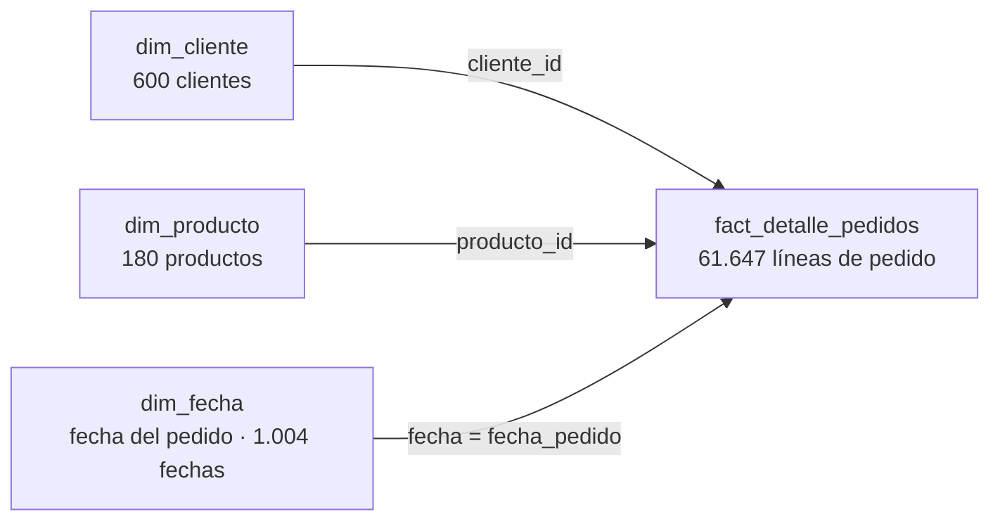
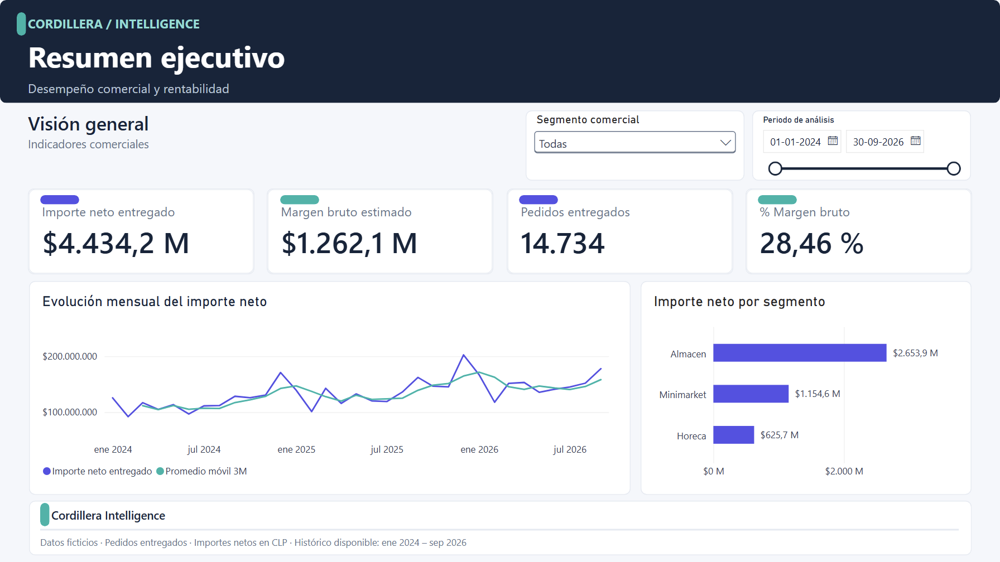
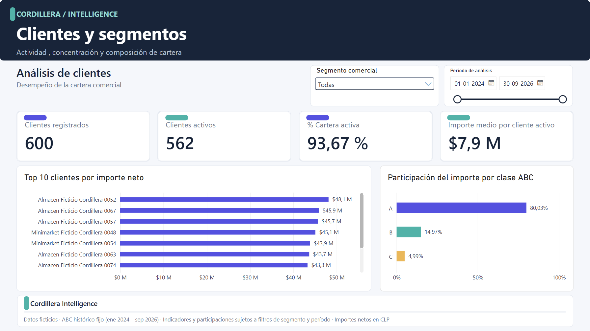
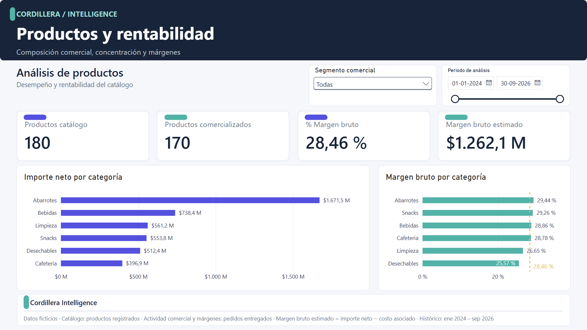
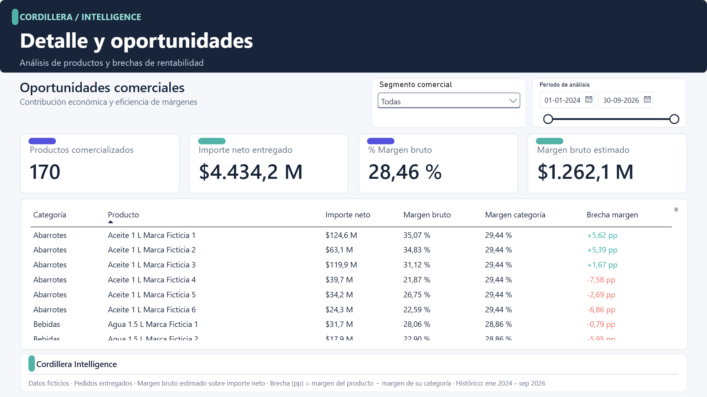

# Commercial Intelligence & Profitability Analytics

Proyecto de portafolio de inteligencia comercial con **SQL, DAX y Power BI**, utilizando datos ficticios de **Distribuidora Cordillera**. El trabajo abarca auditoría de datos, modelado dimensional, análisis comercial y construcción de un informe interactivo para explorar el desempeño, la concentración y el margen bruto estimado.

## Hito 1 · Auditoría y calidad de datos

La auditoría se concentró en cuatro de las 17 tablas de la base: clientes, pedidos, líneas de pedido y productos. Revisé identificadores, relaciones entre tablas, consistencia de fechas y conciliación de importes.

- [Notebook de auditoría](notebooks/01_auditoria_datos.ipynb)
- [Base de datos SQLite](data/distribuidora_cordillera.sqlite)

## Hito 2 · Modelo dimensional con SQL

Construí un esquema estrella con **una fila por línea de pedido**. La vista de hechos calcula el importe neto, el costo y el margen bruto estimado a ese nivel. Las dimensiones permiten analizar esas medidas por cliente, producto y fecha del pedido.

- [Notebook de modelado dimensional](notebooks/02_modelo_analitico.ipynb)
- [Scripts SQL de las cuatro vistas](sql/)



Al unir las tres dimensiones, comprobé que se conservaron las **61.647 líneas únicas**, todas con correspondencia. El importe neto registrado en pedidos entregados coincidió con el obtenido en la auditoría y alcanzó **CLP 4.434.202.034**.

## Hito 3 · Desempeño comercial, concentración y margen bruto estimado

Apliqué el modelo dimensional para analizar la evolución mensual de los pedidos, la actividad de la cartera y el desempeño del catálogo. Con funciones de ventana en SQL calculé variaciones mensuales, promedios móviles y participaciones acumuladas. Luego usé la clasificación ABC para comparar el aporte de cada grupo al importe neto y al margen bruto estimado.

- [Notebook 03 · Desempeño comercial](notebooks/03_desempeno_comercial.ipynb)
- [Notebook 04 · Concentración comercial y rentabilidad bruta estimada](notebooks/04_concentracion_rentabilidad.ipynb)

Entre enero de 2024 y septiembre de 2026, **diciembre de 2025** registró el mayor importe neto mensual, con **CLP 202.353.312** y **695 pedidos entregados**, agrupados por fecha de creación del pedido.

Los **212 clientes** de mayor aporte acumularon el **80,03 %** del importe neto de pedidos entregados. Para alcanzar una proporción similar en el catálogo se necesitaron **94 productos**, que acumularon el **80,05 %**. El grupo de clientes de mayor aporte concentró el **79,83 % del margen bruto estimado total** y tuvo una **tasa de margen del 28,39 %** sobre su propio importe neto.

El análisis monetario usa los importes registrados en pedidos con estado `entregado`. El margen bruto estimado se calcula restando el costo registrado del producto al importe neto.

## Cómo ejecutar los notebooks

Necesitas conda y VS Code con las extensiones **Python** y **Jupyter**. Desde la raíz del repositorio, configura el entorno:

```bash
conda create -n road-to-bi python=3.11
conda activate road-to-bi
python -m pip install -r requirements.txt
```

Si ya tienes el entorno `road-to-bi`, actívalo e instala las dependencias desde `requirements.txt`.

### Notebook 01 · Auditoría

Abre `notebooks/01_auditoria_datos.ipynb` en VS Code, selecciona el kernel `road-to-bi` y pulsa **Run All**. El directorio de trabajo debe ser `notebooks/`, porque la conexión usa la ruta relativa `../data/distribuidora_cordillera.sqlite`.

### Notebook 02 · Modelo dimensional

1. Desde la raíz del repositorio, crea una copia local de la base original. En macOS, `-n` evita sobrescribir una copia que ya tengas.

   ```bash
   cp -n data/distribuidora_cordillera.sqlite data/cordillera_analytics.sqlite
   ```

2. Abre `notebooks/02_modelo_analitico.ipynb`, selecciona el kernel `road-to-bi` y pulsa **Run All** con `notebooks/` como directorio de trabajo. El notebook crea las cuatro vistas en `cordillera_analytics.sqlite`.
3. Al final, la sección **Reproducibilidad del modelo analítico** ejecuta los cuatro scripts de `sql/` sobre una copia en memoria de la base original. La salida muestra el conteo de cada vista y el importe neto de los pedidos entregados.

El repositorio incluye la base original. `cordillera_analytics.sqlite` se genera localmente siguiendo el primer paso de esta sección.

### Notebooks 03 y 04 · Análisis comercial

Ejecuta primero el **Notebook 02** para crear las vistas en `data/cordillera_analytics.sqlite`. Luego abre los notebooks 03 y 04 en VS Code y ejecuta **Run All** en cada uno, con el kernel `road-to-bi` y `notebooks/` como directorio de trabajo. Ambos se conectan a la misma base analítica local. Lee primero el 03 para entender el desempeño comercial y luego el 04 para profundizar en concentración y márgenes.
## Hito 4 · Informe interactivo en Power BI

Llevé el modelo dimensional a Power BI Desktop y construí **Cordillera Intelligence**, un informe de cuatro páginas con filtros de segmento comercial y período sincronizados.

Desarrollé **22 medidas DAX y cuatro columnas calculadas** para calcular indicadores comerciales, analizar la evolución temporal, mantener una clasificación ABC histórica y comparar el margen de cada producto con el de su categoría.

### Criterios del análisis

- Los indicadores de actividad comercial e importes consideran pedidos con estado `entregado`.
- El margen bruto estimado corresponde al importe neto menos el costo registrado del producto. Su porcentaje se calcula sobre el importe neto.
- Un cliente activo tiene al menos un pedido entregado en el contexto seleccionado.
- La clasificación ABC de clientes utiliza el histórico completo y permanece fija al cambiar los filtros. La participación económica de cada clase se recalcula según el segmento y período seleccionados.
- La brecha de margen se expresa en puntos porcentuales y compara el margen del producto con el margen agregado de su categoría.

### Archivos de Power BI y DAX

- [Informe de Power BI · Cordillera_BI.pbix](reports/powerbi/Cordillera_BI.pbix)
- [Definiciones de las 22 medidas DAX](dax/01_medidas.tmdl)
- [Cuatro columnas calculadas para el ABC histórico](dax/02_columnas_abc.tmdl)

Las definiciones DAX se documentan en formato TMDL, con las tablas a las que pertenecen las medidas y columnas. El informe se desarrolló en Power BI Desktop sobre Windows 11 mediante Parallels en Mac.

### Resumen ejecutivo

Indicadores generales, evolución mensual con promedio móvil de tres meses e importe neto por segmento comercial.



### Clientes y segmentos

Actividad de la cartera, principales clientes por importe neto y participación de las clases ABC históricas.



### Productos y rentabilidad

Productos del catálogo y comercializados, importe neto por categoría y comparación de márgenes con la referencia global.



### Detalle y oportunidades

Detalle por producto con importe neto, porcentaje de margen bruto estimado, margen de su categoría y brecha en puntos porcentuales.



Las capturas muestran todos los segmentos y el período enero de 2024 a septiembre de 2026. Los gráficos y tablas con desplazamiento muestran los registros visibles en cada captura.

## Hito 5 · Informe final y recomendaciones comerciales

Consolidé los resultados del análisis en un informe de desempeño comercial, concentración y margen bruto estimado. El documento conecta los hallazgos obtenidos con SQL y Power BI con prioridades de revisión comercial.

Entre los principales resultados:

- Los pedidos entregados acumularon **CLP 4.434,2 millones de importe neto**, con un **margen bruto estimado del 28,46 %**.
- La clase A de clientes concentró el **80,03 % del importe neto**, mientras que **94 productos de los 180 registrados** explicaron el **80,05 %**.
- La comparación del margen de cada producto con el de su categoría permitió identificar casos para revisar precios, costos y condiciones comerciales.

El informe incluye recomendaciones priorizadas y explicita el alcance y las limitaciones del análisis. Los datos son ficticios y las recomendaciones no representan mejoras económicas ya obtenidas.

- [Consultar el informe final en PDF](reports/Cordillera_Informe_Final.pdf)
