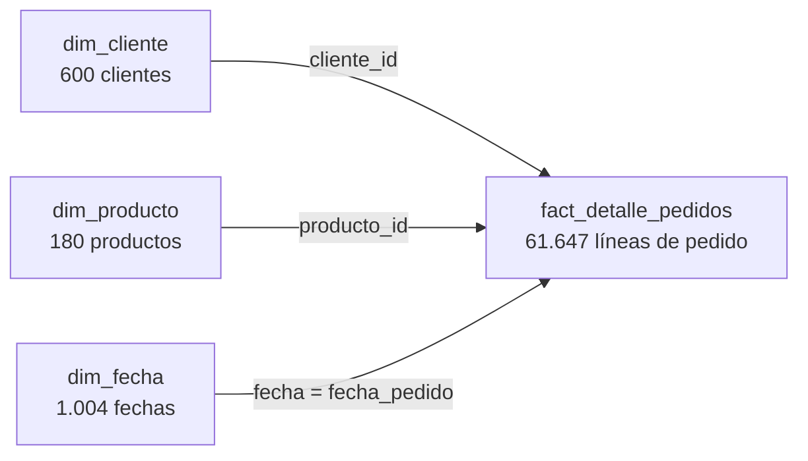

# Commercial Intelligence & Profitability Analytics

Proyecto de portafolio de análisis comercial con SQL sobre **Distribuidora Cordillera**, una empresa ficticia. El objetivo es construir indicadores de desempeño comercial y rentabilidad estimada a partir de datos auditados.

## Hito 1 · Auditoría y calidad de datos

La auditoría se concentró en cuatro de las 17 tablas de la base: clientes, pedidos, líneas de pedido y productos. Revisé identificadores, relaciones entre tablas, consistencia de fechas y conciliación de importes.

- [Notebook de auditoría](notebooks/01_auditoria_datos.ipynb)
- [Base de datos SQLite](data/distribuidora_cordillera.sqlite)

## Hito 2 · Modelo dimensional con SQL

Construí un esquema estrella con **una fila por línea de pedido**. La vista de hechos calcula el importe neto, el costo y el margen bruto estimado a ese nivel. Las dimensiones permiten analizar esas medidas por cliente, producto y fecha del pedido.

- [Notebook de modelado dimensional](notebooks/02_modelo_analitico.ipynb)
- [Scripts SQL de las cuatro vistas](sql/)



Al unir las tres dimensiones, comprobé que se conservaron las **61.647 líneas únicas**, todas con correspondencia. El importe neto asociado a pedidos entregados coincidió con la auditoría: **CLP 4.434.202.034**. Es un importe registrado en pedidos entregados. El margen usa el costo de producto registrado y se interpreta como una estimación bruta.

## Cómo ejecutar los notebooks

Necesitas conda y VS Code con las extensiones **Python** y **Jupyter**. Desde la raíz del repositorio, configura el entorno:

```bash
conda create -n road-to-bi python=3.11
conda activate road-to-bi
python -m pip install -r requirements.txt
```

Si ya tienes el entorno `road-to-bi`, actívalo e instala las dependencias desde `requirements.txt`.

### Notebook 01 · Auditoría

Abre `notebooks/01_auditoria_datos.ipynb` en VS Code, selecciona el kernel `road-to-bi` y pulsa **Run All**. El directorio de trabajo debe ser `notebooks/`, porque la conexión usa la ruta relativa `../data/distribuidora_cordillera.sqlite`.

### Notebook 02 · Modelo dimensional

1. Desde la raíz del repositorio, crea una copia local de la base original. En macOS, `-n` evita sobrescribir una copia que ya tengas.

   ```bash
   cp -n data/distribuidora_cordillera.sqlite data/cordillera_analytics.sqlite
   ```

2. Abre `notebooks/02_modelo_analitico.ipynb`, selecciona el kernel `road-to-bi` y pulsa **Run All** con `notebooks/` como directorio de trabajo. El notebook crea las cuatro vistas en `cordillera_analytics.sqlite`.
3. Al final, la sección **Reproducibilidad del modelo analítico** ejecuta los cuatro scripts de `sql/` sobre una copia en memoria de la base original. La salida muestra el conteo de cada vista y el importe neto de pedidos entregados.

El repositorio incluye la base original. `cordillera_analytics.sqlite` se genera localmente siguiendo el paso anterior.

## Próximo hito

Usar el modelo para analizar la evolución comercial, la concentración y el margen bruto estimado. El informe en Power BI corresponde a una etapa posterior.
